# Gerente de carreiras · R2

Versão: v8 (28/09/2026)
Espelho em texto de playbook-closer.html. Autoridade e casos: CASOS.md.
Uso interno: este é o playbook da função Closer na dashboard. Para a família, usar sempre **gerente de carreiras**. O atendimento anterior foi do gerente de carreiras da R1.
Tudo entre colchetes vem do CRM, do contrato ou da operação. R$ ____ é preenchido com a proposta correta.

Revisão v8: condução da decisão, demonstração A + B da oferta, Zyron em linguagem simples, David Willer e AGN, ancoragem com material de reforço e objeções aprofundadas. Substitui as orientações das versões anteriores.

## 01. Missão: transformar compreensão em decisão

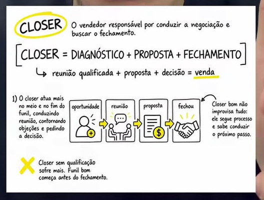

O gerente de carreiras da R2 chega conhecendo o atleta, mostra como o trabalho responde à necessidade da família e pede uma decisão clara. **Conhecer o caso, demonstrar valor e conduzir o próximo passo** são a base da autoridade.

Quatro princípios:
1. Continuar a R1: usar os nomes, o contexto, a análise e as palavras da família.
2. Fazer o futuro parecer compreensível: cada entrega precisa ter uma utilidade concreta.
3. Mostrar a prova antes de pedir confiança; explicar o investimento depois do valor.
4. Resolver a objeção específica e pedir uma decisão, sem ficar girando no mesmo argumento.

> "Hoje eu quero ligar o que vocês me contaram ao plano do [atleta]. Vou mostrar como funciona, quem acompanha, o investimento e os próximos passos. No final, a gente decide se faz sentido avançar."

Caminho: **CRM → conexão → necessidade → cenário → demonstração → prova → ancoragem → proposta → decisão**.

Uma boa R2 termina com contratação consciente, pendência específica com retorno marcado ou encerramento claro. O retorno da equipe só é usado quando há algo real para ela avaliar.

## 02. Preparação: chegar sabendo muda a conversa

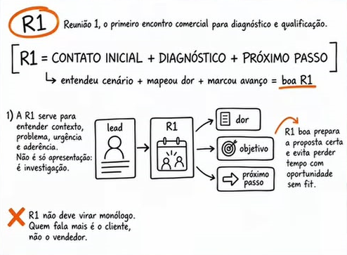

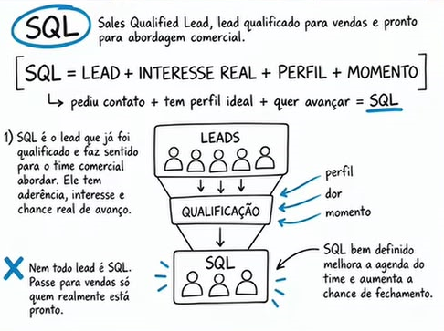

Reservar dez minutos antes da R2 para conferir a ficha, o vídeo e a devolutiva. Se faltar análise essencial, alinhar a pendência antes de apresentar um plano como se estivesse concluído.

| Informação da R1 | Como usar |
| --- | --- |
| Atleta, responsável legal e demais participantes | Chamar pelo nome e incluir quem decide |
| Objetivo do atleta | Relacionar ao compromisso de rotina e à visão de futuro |
| Dor nas palavras da família | Resumir, confirmar e conectar à entrega |
| Avaliações, tempo observado e retorno recebido | Explicar por que análise e acompanhamento importam |
| Resultado da Zyron e revisão humana | Abrir a demonstração com algo do próprio atleta |
| O que já tentaram e os gastos citados | Comparar o trabalho que receberam, sem usar gasto passado como dívida emocional |
| Orçamento ou restrição informada | Apresentar uma proposta que possa ser avaliada com responsabilidade |
| Locomoção, escola e vínculos atuais | Definir o que é viável antes de falar de destino |
| Caso e links mostrados | Continuar a mesma história e acrescentar prova pertinente |
| Dúvida ainda aberta | Resolver cedo, sem esperar ela reaparecer no pagamento |

Preparar: relatório demonstrável, caso autorizado, perfis do David e da AGN, material de reforço de ancoragem, escopo do plano, contrato, condições de pagamento e previsão real de início.

> "[responsável], aqui é o [nome], gerente de carreiras. Estou com a ficha do [atleta] para nossa conversa das [hora]. Separei [material real] para explicar [necessidade]. [participantes] confirmados?"

**Internamente:** a fila continua sendo Closer. Assumir o lead correto e preservar a linha do tempo. Não criar outra ficha para o mesmo atleta.

## 03. Condução firme: agenda, diagnóstico e próximo passo

A firmeza está na organização da conversa e na capacidade de resolver a dúvida. Voz calma, frases curtas, uma pergunta por vez. Deixar a família terminar a resposta.

### Abrir um acordo

> "Primeiro confirmo o que vocês precisam. Depois mostro o plano e a prova. Por último, investimento e decisão. Se algum ponto não fizer sentido, me interrompam."

### Quando puxarem preço cedo

> "Eu vou te passar o valor nesta conversa. Antes, preciso te mostrar exatamente o que está incluído, para você saber o que está comparando. Se preço for um limite para continuar, a gente trata disso agora."

### Quando aparecerem três objeções ao mesmo tempo

> "Anotei três pontos: [confiança], [tempo] e [valor]. Qual deles pesa mais? Vamos resolver um de cada vez."

### Quando a conversa ficar vaga

> "Quando você diz 'não sei', o que está faltando: clareza sobre o trabalho, confiança na entrega ou condição para contratar?"

### Quando estiverem prontos

> "Pelo que vocês confirmaram, o plano responde a [necessidade] e as condições estão claras. Querem iniciar o acompanhamento?"

Silêncio é espaço para responder, não uma disputa para ver quem cede primeiro.

### Sagacidade: trocar discurso por um ponto que a família consiga conferir

**Demonstração curta, antes de mais argumento:**

> "Você não precisa imaginar como a gente trabalha. Me dá 90 segundos: vou abrir uma entrega real e ligar isso ao que você disse que falta para o [atleta]."

**Confirmar o critério de decisão:**

> "Para você considerar esse plano, precisa ver [entrega], confiar em [responsável] e entender [condição]. Acertei? Vamos conferir os três."

**Pergunta incisiva depois da prova:**

> "Essa demonstração respondeu ao que você estava receoso ou ainda tem um ponto que eu não enxerguei? Quero tratar a dúvida certa."

**Parar de empilhar argumentos quando houver compreensão:**

> "Você já entendeu o trabalho, viu quem acompanha e conferiu a condição. O que falta para tomar uma decisão sobre esse plano?"

Se aparecer um limite real, trabalhar esse limite. Se a família já decidiu que não quer, encerrar. Firmeza é manter clareza e direção.

## 04. R2: conexão e dor com precisão

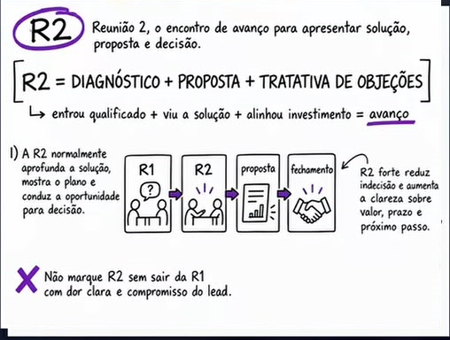

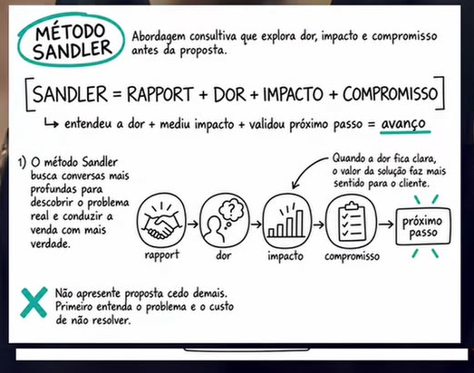

Duração de referência: 45 a 60 minutos, ajustada à necessidade. O responsável legal participa da decisão de menores.

### 4.1 Mostrar que a história foi ouvida

> "[atleta], li tua conversa com o [nome do gerente de carreiras da R1]. Você falou que quer [objetivo], mas hoje sente falta de [necessidade]. E no teu material apareceu [observação real]. É por aí?"

> "[responsável], você destacou [dor literal]. O que mais importa resolver primeiro?"

Não repetir o cadastro. Se algo mudou desde a R1, atualizar.

### 4.2 A pergunta do olhômetro

> "Vocês contaram que foram a [quantidade] avaliações e receberam [tipo de retorno]. A sensação foi de terem entendido o jogo dele ou de terem saído ainda no escuro?"

> "Um olhar rápido pode enxergar um bom lance. Mas ele responde sozinho o que o atleta precisa desenvolver e qual caminho faz sentido depois?"

Se discordarem, explorar a experiência em vez de forçar um "não".

> "O que vocês gostariam de acrescentar à avaliação que já tiveram?"

### 4.3 A dificuldade e seu efeito concreto

- "Onde essa falta de direção atrapalha mais hoje?"
- "O que vocês tentaram fazer para resolver?"
- "Qual parte do gasto e do esforço trouxe algum retorno útil?"
- "O que vocês não querem repetir na próxima tentativa?"

> "Então a questão não é só participar de mais uma avaliação. É entender [necessidade específica] e ter acompanhamento para [mudança desejada]. Acertei?"

### 4.4 Importância e prontidão são coisas diferentes

> "De zero a dez, quanto essa mudança importa para vocês? O que faz ela ter esse peso?"

> "E o que precisa estar resolvido para vocês considerarem um acompanhamento agora?"

Alta vontade não significa capacidade financeira. Aperto financeiro não significa falta de apoio ao atleta.

### 4.5 Abrir a proposta com uma necessidade definida

> "Se eu mostrar como o plano trabalha [necessidade], quem acompanha e como vocês verificam as entregas, isso responde ao principal ponto de vocês?"

Se a resposta for vaga, esclarecer a necessidade antes de acumular argumentos.

## 05. Imaginação: ligar o sonho ao caminho

O atleta pode visualizar o futuro que deseja. O gerente deve construir a ponte com ações possíveis, sem anunciar sucesso esportivo como consequência do pagamento.

### O atleta que quer ser visto

> "[atleta], imagina chegar numa conversa sobre teu futebol sabendo explicar tua posição, tua história e o que você está trabalhando. Ter um material organizado, alguém que conhece teu caso e um próximo passo definido. O que isso muda na tua confiança?"

> "A camisa do [clube dos sonhos] representa o destino que você quer. Hoje a gente precisa cuidar do caminho que está ao alcance: avaliação, desenvolvimento e apresentação."

### A família cansada de tentativas soltas

> "[responsável], imagina a próxima atualização sem precisar perguntar para cinco pessoas. Você sabe quem responde pelo acompanhamento, o que foi feito e o que falta. Qual parte disso aliviaria a rotina de vocês?"

### Medo de perder tempo

> "O que dá para começar a organizar agora e faria diferença nos próximos [período de acompanhamento]? Vamos trabalhar com a categoria e a situação real dele."

Não criar uma data de validade para o sonho. Se houver prazo esportivo concreto, explicar qual competição, categoria ou evento o determina.

### Dificuldade financeira

> "Eu entendo o quanto vocês querem dar uma chance a ele. Para esse plano ajudar, precisa caber na realidade de vocês. Vamos ver o que está incluído, o custo total e as opções existentes."

Nunca apresentar futebol como saída garantida da pobreza nem desvalorizar estudo ou outras profissões.

### O compromisso do atleta

> "[atleta], se tiver orientação, o que você se compromete a fazer? Qual horário de treino você consegue manter? Como vai separar material e participar das devolutivas?"

O compromisso é com a rotina, não com convencer os pais a pagar.

## 06. A + B: o que entregamos e por que faz sentido

### 6.1 A proposta em uma frase

> "O plano junta análise automática da Zyron, acompanhamento de um gerente de carreiras e trabalho de orientação para oportunidades compatíveis. Você consegue ver o que está sendo feito, por quem e em qual prazo."

### 6.2 A Zyron sem termos complicados

> "O DVD é o vídeo do [atleta] jogando. A Zyron analisa esse material automaticamente. A equipe de gestores de carreiras revisa o resultado com o histórico dele; um analista de carreiras faz a devolutiva. O gerente de carreiras usa essa informação para orientar o plano e os próximos passos."

**Três movimentos de demonstração:**
1. **O material:** "Este é o vídeo que recebemos e esta é a análise disponível."
2. **A leitura:** "Aqui apareceu [achado real]. A equipe interpretou isso junto com [contexto]."
3. **A ação:** "A partir daí, o próximo passo proposto é [ação que a equipe realmente entrega]."

> "Percebe a diferença entre receber uma nota e receber uma direção?"

Não descrever agentes 24 horas, métricas ou integrações que não estejam disponíveis.

### 6.3 Um exemplo fácil de aplicação

Exemplo ilustrativo para explicar o processo, não um caso real:

> "Pensa num meia que tem um material interessante, mas ainda não sabe como se apresentar. A análise e a revisão ajudam a discutir o perfil. A equipe organiza o que precisa ser trabalhado e considera caminhos compatíveis com posição, categoria e contexto. Se houver uma oportunidade concreta, confere as exigências antes de apresentar o atleta."

> "A tecnologia ajuda a analisar. A equipe precisa entender o atleta e fazer o trabalho de acompanhamento. A decisão esportiva continua com quem avalia no clube."

### 6.4 IA já é usada profissionalmente

> "Isso já faz parte do futebol profissional no Brasil e fora há anos. O diferencial aqui é vocês acessarem a Zyron dentro de uma assessoria que explica a análise e acompanha os próximos passos."

Referências do setor: [Botafogo e SkillCorner, 2024](https://botafogo.com.br/noticias/monitoramento-ampliado); [Chelsea e AiSCOUT, 2022, após dois anos de trabalho conjunto](https://www.chelseafc.com/en/news/article/aiscout-announced-as-official-academy-research-partner). Explicam o uso de IA no futebol; não representam vínculo desses clubes com a Zyron ou com o atleta.

Não atribuir anos de funcionamento à Zyron ou dizer que a tecnologia só foi aberta recentemente ao público sem um marco confirmado.

### 6.5 A tabela que torna a oferta concreta

Preencher com o escopo efetivo antes de apresentar. Não incluir profissionais ou serviços ausentes do plano.

| Necessidade que ouvimos | Trabalho contratado | Como a família acompanha |
| --- | --- | --- |
| "Não entendo a avaliação" | Análise da Zyron e devolutiva prevista no plano | [resultado mostrado], [analista] e [data] |
| "Falta direção" | Orientação do gerente de carreiras | [plano de acompanhamento], [canal] e [frequência] |
| "As tentativas ficam soltas" | Organização dos próximos passos incluídos | [registro das ações] e [próxima atualização] |
| "Não sei como apresentar o perfil" | [preparação de material incluída] | Material revisado e explicação de uso |
| "Quero entender oportunidades" | Avaliação de caminhos e contatos previstos no escopo | Requisitos, ações realizadas e retorno real, quando houver |

> "Você falou [dor]. Esta parte do plano existe para trabalhar exatamente isso. Aqui está quem faz e como vocês acompanham."

### 6.6 Experiência e conexões

> "O David Willer é o expert. Entre os casos do trabalho dele estão Kaio no Internacional e Joãozinho profissionalmente no Grêmio. O histórico da operação vai além desses nomes, com centenas de jogadores encaminhados no Brasil e no mundo."

> "A AGN Football é um braço complementar, com dezenas de atletas e atuação no caminho para o exterior. Ela amplia essa frente da operação. O acompanhamento do [atleta] continua tendo responsável e entregas definidos aqui."

Mostrar [David Willer](https://www.instagram.com/dwilleroliveira/) e [AGN Football](https://www.instagram.com/agnfootball/), além do caso específico preparado. Não usar o nome de um clube para insinuar vaga aberta ou contratação garantida.

### 6.7 Quem faz o quê

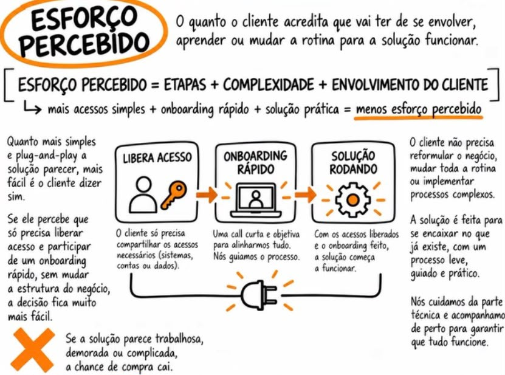

**Aplicação:** simplificar a participação da família sem prometer que ela não fará nada.

> "A equipe assume [análise, orientação e ações incluídas]. Do [atleta], precisamos de [rotina e material]. De vocês, [apoio e participação combinados]. O contato é [canal], com retorno em [frequência]. Vocês não ficam adivinhando a quem perguntar."

### 6.8 Três prazos que não podem virar um só

| Prazo | Como apresentar |
| --- | --- |
| Análise do DVD | [data/hora] para análise ou atualização de status, com analista responsável |
| Início do acompanhamento | [primeiro contato e primeira entrega] após contratação, conforme capacidade real |
| Encaminhamento a clube | Depende do perfil, requisitos e oportunidades; explicar cada etapa concreta |

> "Sobre prazo, eu separo as coisas: a devolutiva fica para [data]; o acompanhamento começa em [data]; clube depende de uma oportunidade compatível e da avaliação de quem recebe. Eu não vou misturar esses três momentos."

Só citar média de encaminhamento quando houver base definida: resultado contado, período, número de atletas e casos ainda em andamento. A referência antiga de três meses não entra como promessa pronta.

## 07. Ancoragem: o valor precisa ser entendido antes do número

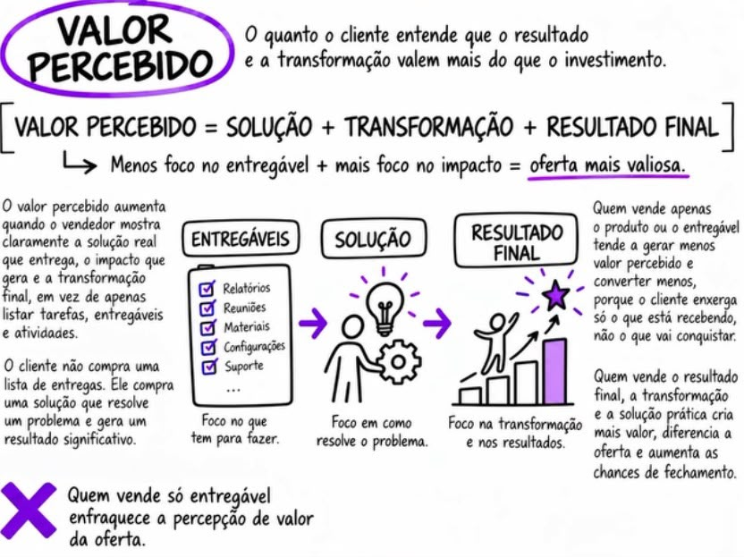

**Aplicação:** a família precisa entender a utilidade do acompanhamento, quem o executa e o que recebe. O material comercial de reforço faz a ancoragem detalhada; este roteiro conduz sua apresentação.

### A sequência

1. Retomar a dificuldade nas palavras da família.
2. Mostrar a entrega que responde a ela.
3. Abrir o **material de reforço de ancoragem** aprovado pela operação.
4. Comparar escopo, duração e responsabilidades equivalentes.
5. Explicar o custeio de profissionais e tecnologia.
6. Apresentar a proposta e deixar a família responder.

### Falas para a ancoragem

> "Vocês disseram que o mais difícil é [necessidade]. Antes de falar em preço, olha o que entra para trabalhar isso: [entregas do plano]."

> "Se fossem organizar por conta própria, precisariam resolver análise, orientação e acompanhamento, além de descobrir com quem falar em cada etapa. Vamos comparar o que o material mostra e o que de fato está incluído aqui."

> "O investimento custeia os profissionais envolvidos e a inteligência artificial. O objetivo da parceria é desenvolver o trabalho com o atleta; as condições sobre eventual contrato profissional ficam claras no contrato."

Quando houver cotações equivalentes no material:

> "Estes valores são de [fonte e data], para [escopo]. É com essa comparação que você consegue avaliar o plano."

Sem cotação, comparar a organização do trabalho e os entregáveis, sem inventar quanto seria mais caro contratar por fora.

### O número, sem esconder o total

> "Para [escopo e duração], o investimento total é de R$ ____. A condição disponível é [número] parcelas de R$ ____, [com/sem juros e total parcelado]. À vista, a condição é [condição real]."

Pausar para ouvir. Não emendar desconto nem diminuir o valor de uma quantia que pode ser relevante para a família.

> "Qual parte vocês querem avaliar: o que está incluído, a condição de pagamento ou a confiança no trabalho?"

### Planos de referência interna

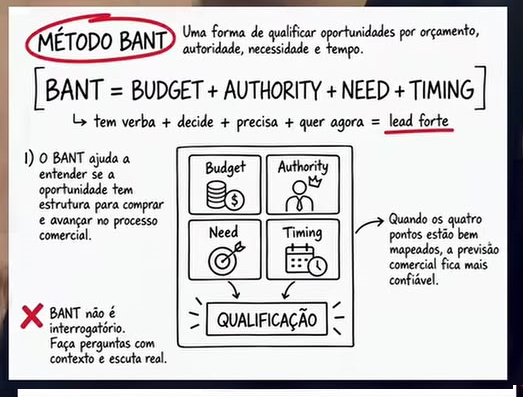

| Plano | Valor registrado na operação | Uso |
| --- | --- | --- |
| Principal | R$ 2.997 | Apresentar quando o escopo responder à necessidade e puder ser avaliado pela família |
| Intermediário | R$ 1.497 | Alternativa existente com diferenças de escopo explicitadas |
| Entrada | R$ 497 | Formato de entrada, se suas entregas realmente atenderem à necessidade |

Confirmar tabela, duração, escopo e condições vigentes antes da proposta. Não apresentar o mesmo serviço com três preços nem calcular valor diário a partir de um prazo presumido para chegar a clube.

> "Existe um formato mais enxuto. Ele inclui [entregas] e deixa de incluir [diferenças]. Quero que vocês escolham sabendo o que muda."

O plano menor é uma proposta diferente, não uma promessa igual com desconto disfarçado.

## 08. Fechamento: decisão agora ou pendência resolvida

### Modo A: a família entendeu e quer iniciar

1. **Resumo:** "O que vocês querem é [objetivo]. O que faltava era [necessidade]. O plano trabalha isso com [entregas]."
2. **Confirmação:** "Escopo, duração, acompanhamento e investimento ficaram claros?"
3. **Decisão:** "Vocês querem iniciar o acompanhamento do [atleta] nesse formato?"
4. **Pagamento após o sim:** "Certo. Entre as condições apresentadas, qual funciona melhor?"
5. **Próximo passo:** "Após a confirmação, [responsável] entra em contato até [data/hora] para [primeira entrega]."

Enviar o contrato e o resumo da proposta, dando espaço para leitura. Não transformar envio do Pix em substituto da concordância.

### Modo B: falta uma resposta concreta

Usar para uma dúvida técnica, escopo a confirmar, participante ausente ou necessidade real de avaliação da equipe.

> "Hoje ficou pendente [ponto]. Eu vou confirmar com [responsável] e volto até [dia/hora], trazendo [resposta ou material]. Aí vocês avaliam com essa informação na mão."

> "Além desse ponto, tem alguma outra dúvida que eu preciso levar?"

No retorno:

> "Você me pediu clareza sobre [ponto]. Confirmei [resposta real]. Vou te mostrar. Isso resolve a dúvida ou ficou alguma parte aberta?"

Se resolver e houver interesse:

> "Com isso esclarecido, vocês querem iniciar no plano que conversamos?"

Não apresentar uma aprovação teatral da equipe para criar obrigação de compra.

### Quando a resposta é não

> "Entendi. Vou registrar [motivo, se quiserem informar] e encerrar a proposta. Se o cenário mudar, vocês podem retomar pelo mesmo contato."

### Capacidade limitada real

Se houver uma turma ou agenda limitada, informar apenas dado atual, condição e prazo reais:

> "Hoje conseguimos iniciar [quantidade confirmada] acompanhamentos em [data]. Se essa agenda mudar, eu te aviso. O que vocês precisam esclarecer para decidir?"

## 09. Objeções: descobrir o bloqueio e responder no ponto

Sequência: **acolher → esclarecer → demonstrar → conferir → pedir o próximo passo**. Cada resposta deve resolver uma dúvida, não aumentar a pressão.

### 9.1 "Está muito caro"

**Primeira pergunta:**

> "Quando você diz caro, é porque o valor não cabe agora, porque ainda não enxergou a entrega ou porque não confia que o trabalho vai acontecer?"

**Se for valor percebido:**

> "Vamos voltar ao que vocês querem resolver: [necessidade]. Esta entrega responde a isso de que maneira, na visão de vocês? O que ainda falta para a comparação fazer sentido?"

Mostrar o material de reforço e uma entrega real, sem repetir a apresentação inteira.

**Se for confiança:**

> "Diminuir o preço não resolveria essa dúvida. Vamos conferir quem acompanha, o contrato e um exemplo do trabalho. Qual desses pontos você quer ver primeiro?"

**Se for orçamento:**

> "O limite é o total do investimento ou a forma de pagamento? Posso te mostrar as condições que realmente existem, sem mudar o que foi combinado."

Explicar total, parcelas e encargos. Se houver outro plano, mostrar exatamente o que sai e o que permanece.

**Pergunta de avanço:**

> "Com [dúvida] resolvida e essa condição na mesa, faz sentido contratar, ou ainda existe um limite que precisamos respeitar?"

Se não couber sem comprometer despesas essenciais, encerrar ou combinar retomada. Não usar o sonho do atleta para produzir culpa.

### 9.2 "Parcela de X ainda pesa"

> "A parcela precisa caber. São [número] parcelas de R$ ____, total de R$ ____, para [escopo e duração]. Considerando isso inteiro, qual parte ficou inviável?"

> "Se o formato menor atender [necessidade], eu explico a diferença. Se não atender, não vou te oferecer algo só para caber na parcela."

### 9.3 "Meu filho só quer uma oportunidade, não um serviço"

> "Faz sentido: o objetivo dele é jogar. O acompanhamento é o trabalho que organiza a caminhada até as oportunidades. Vamos separar o objetivo final do que estamos contratando agora."

> "Se vocês já têm análise, direção e alguém acompanhando esse caminho, precisamos entender o que faltaria aqui. Se não têm, é esse trabalho que eu estou te mostrando."

### 9.4 "Empresário bom ganha no contrato"

> "A negociação de um contrato e a assessoria durante a caminhada têm trabalhos diferentes. Aqui o investimento sustenta [profissionais, tecnologia e entregas previstas]. A participação em eventual contrato profissional segue as condições acordadas."

> "O ponto é: o que vocês recebem durante esse período justifica o investimento para vocês? Vamos avaliar isso com clareza."

### 9.5 "Tenho medo de ser golpe"

> "Você está certo em conferir. Vamos por partes: identidade da empresa, contrato, quem atende, prova do trabalho e condições de pagamento."

Mostrar cadastro institucional e contrato disponíveis, os perfis do David e da AGN e o caso autorizado. Usar canal de pagamento oficial da operação.

> "O que ainda precisa ficar verificável para você se sentir seguro? Quero resolver essa dúvida antes de qualquer pagamento."

### 9.6 "Vocês garantem clube? É tiro certo?"

> "Tiro certo, para nós, precisa significar trabalho direcionado: analisar o perfil, orientar e buscar caminhos compatíveis. Contratação é decisão do clube. O que eu posso assumir está aqui: [entregas], [responsável] e [prazos]."

> "Você está buscando garantia de contrato ou quer avaliar um acompanhamento com entregas claras? Preciso ser preciso com você sobre essa diferença."

### 9.7 "Em quanto tempo ele vai para um clube?"

> "Você quer saber o prazo para receber a análise, para começar o acompanhamento ou para ter uma avaliação de clube? São etapas diferentes."

Informar os dois primeiros conforme agenda real. No terceiro, apresentar apenas dados históricos documentados e comparáveis, quando existirem, sem converter média em prazo individual.

> "Para o [atleta], hoje o próximo marco é [ação e data]. É esse avanço que conseguimos acompanhar juntos."

### 9.8 "Vou pensar"

> "Claro. Qual é a parte principal que você quer pensar: o plano, a confiança ou o investimento? Talvez eu consiga te entregar a informação que falta."

> "Prefere que eu envie o resumo e a gente retome [dia/hora], ou você prefere entrar em contato quando decidir?"

Se escolher retorno, confirmar qual questão será resolvida. Não cobrar um "sim" como dívida de uma fala anterior.

### 9.9 "Preciso conversar com outra pessoa"

> "O que essa pessoa precisa entender para participar da decisão? Posso enviar o resumo e fazer uma conversa curta com vocês juntos."

Não pedir que um participante pressione o outro; facilitar informação completa.

### 9.10 "Manda a proposta no WhatsApp"

> "Mando sim: objetivo, escopo, duração, quem acompanha, valor total e condições. Qual ponto você quer olhar com mais cuidado para eu destacar?"

Enviar a proposta aprovada. Não condicionar informação básica a outra chamada.

### 9.11 "Já tentamos peneira e não deu em nada"

> "O que vocês receberam depois da tentativa? Alguma orientação ou só o resultado?"

> "Aqui a diferença que precisamos avaliar é [análise, devolutiva e acompanhamento incluídos]. Vou mostrar isso funcionando, para você comparar trabalho com trabalho."

Não dizer que toda peneira é inútil ou que toda assessoria concorrente trabalha errado.

### 9.12 "Não temos como viajar / ele é novo"

> "Então isso entra como limite do plano. Antes de qualquer avaliação fora, precisamos considerar companhia, escola, custos e requisitos. O que dá para trabalhar agora sem ultrapassar esse limite?"

Não prometer custeio, alojamento ou transferência internacional de menor sem condições confirmadas.

### 9.13 "Já tem clube ou empresário"

> "Qual trabalho já está coberto e qual falta? Só faz sentido conversar se existir uma contribuição complementar e compatível com os vínculos dele."

### 9.14 "A IA vai decidir se meu filho presta?"

> "Não é esse o papel. A Zyron analisa o material; a equipe conversa sobre o resultado e o contexto. Uma análise não resume a pessoa nem decide sozinha uma carreira."

> "Vamos olhar um exemplo do que ela entrega e como o analista explica isso."

### 9.15 "A AGN leva para a Europa?"

> "A AGN é um braço complementar com atuação no caminho para o exterior. Temos dezenas de atletas pela AGN dentro desse histórico. Isso não transforma qualquer destino em vaga disponível. Para o [atleta], primeiro precisamos entender perfil, requisitos e oportunidade."

Mostrar um caso real da frente internacional, se preparado, sem inventar nome, país ou vínculo.

### 9.16 "Quero começar, mas não hoje"

> "O que muda entre hoje e [data]? Se for organização financeira ou participação de alguém, vamos registrar o que precisa acontecer."

> "Posso te enviar o resumo e confirmar a disponibilidade real mais perto dessa data. Prefere assim?"

## 10. Depois do sim: a confiança precisa continuar

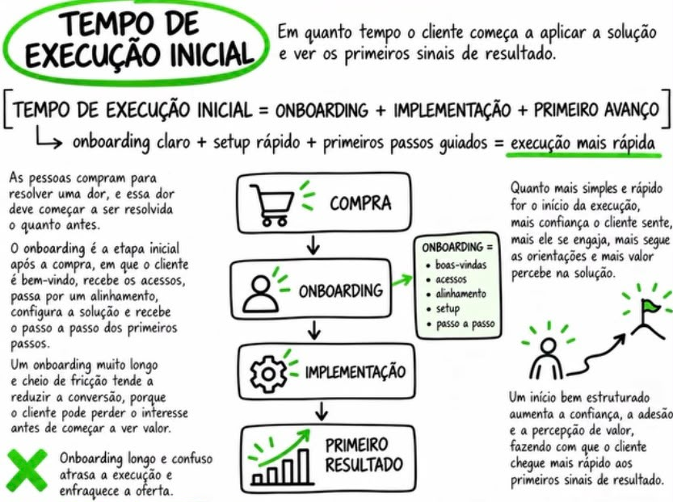

**Aplicação:** trocar a espera vaga por início com responsável, data e resultado esperado. Só prometer o prazo que a equipe consegue cumprir.

1. Confirmar contrato, plano, escopo, duração e pagamento no canal oficial.
2. Registrar o desfecho no CRM.
3. Cadastrar a venda financeira uma única vez, vinculada ao lead, com produto e ticket corretos. Ela fica pendente até a aprovação do Executive.
4. Passar a ficha ao responsável pelo acompanhamento, incluindo expectativas e objeções.
5. Informar a primeira entrega e o próximo contato.
6. Conferir se a família recebeu os materiais e sabe com quem falar.

> "Bem-vindos, [responsáveis] e [atleta]. O plano contratado é [plano], com [escopo e duração]. O gerente de carreiras [nome] chama vocês até [data/hora]. A primeira entrega é [entrega]. O contato para acompanhar é [canal]."

### Se o DVD ainda precisar de complemento

> "Para concluir a análise, falta [material]. Assim que chegar, a equipe confirma a previsão e o analista de carreiras retorna com o resultado. Até [dia/hora] vocês recebem uma atualização."

### Se houver atraso

Avisar antes do prazo, explicar o status real e combinar a nova previsão com responsável. Não sumir após o pagamento.

### Indicação

Depois de uma entrega útil ou sinal de satisfação:

> "Conhece outro atleta que gostaria de entender esse trabalho? Pode compartilhar nosso contato. A gente conversa com ele e com o responsável."

## 11. Depois do ainda não: voltar com motivo

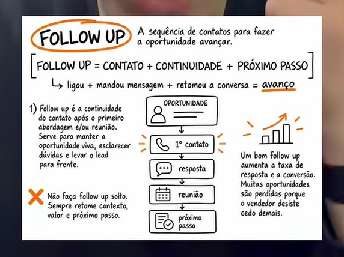

| Momento | Ação |
| --- | --- |
| Mesmo dia | Enviar resumo da proposta, links e dúvida pendente registrada |
| Horário combinado | Entregar a resposta prometida, com responsável e evidência |
| D3, se houver interesse | Caso ou demonstração diretamente ligado à objeção |
| D7 | "O ponto [dúvida] ficou esclarecido? Querem avançar, ajustar a conversa ou pausar?" |
| D14 | Confirmar se encerra ou se há uma data concreta de retomada |
| Depois | Devolver para o fluxo interno SDR quando apropriado, preservando o histórico e a preferência de contato |

A cadência se adapta ao combinado. Recusa explícita encerra o contato comercial. Sem novidade ou pergunta útil, não mandar "e aí, pensou?" todos os dias.

## 12. Números que ajudam a melhorar

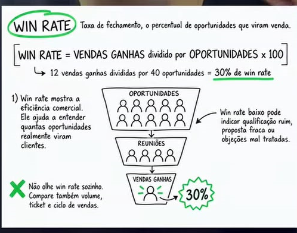

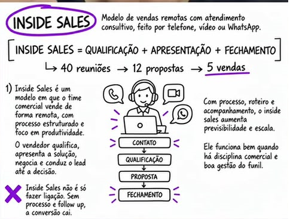

Os números dos cards são exemplos de treinamento. Medir a operação com período e critérios estáveis.

| Sinal | O que investigar |
| --- | --- |
| Muito "caro" | A família entendeu entrega, duração e prova? Ou existe limite financeiro real? |
| Muita desconfiança | Contrato, identidade, casos e demonstração estão acessíveis? |
| Repetição de perguntas da R1 | Ficha incompleta ou preparação insuficiente |
| Faltas | Motivo da reunião, horário e participantes ficaram claros? |
| Muitos retornos sem avanço | A pendência foi definida e a informação prometida foi entregue? |
| Cancelamentos e reclamações | A venda criou uma expectativa diferente do serviço entregue? |

Acompanhar R2 realizadas, conversão, ticket, tempo até decisão, motivo de perda e qualidade das primeiras entregas. Distinguir fechamento no CRM de receita aprovada. Não inventar meta de conversão a partir de exemplos do livro.

## 13. Regras de ouro da condução

- Ler a ficha antes da R2 e usar as palavras da família.
- Apresentar-se como gerente de carreiras.
- Fazer uma pergunta por vez e confirmar a dúvida principal.
- Ligar cada entrega a uma necessidade.
- Mostrar a Zyron de forma simples, com resultado real.
- Usar David e AGN como autoridade contextualizada.
- Apresentar o material de reforço antes do preço.
- Informar valor total, parcelas, duração e diferenças entre planos.
- Pedir uma decisão clara depois que houver compreensão.
- Retornar com data e conteúdo definidos quando faltar algo.
- Respeitar o não e os limites do orçamento.
- Fazer a primeira entrega corresponder ao que foi vendido.

**Treino da equipe:** ensaiar "caro por falta de confiança", "caro por falta de orçamento" e "quero só clube". A resposta deve mudar conforme o motivo. Repetir o mesmo discurso nos três casos é falhar no diagnóstico.

## 14. Casos, AGN e bastidores que sustentam a conversa

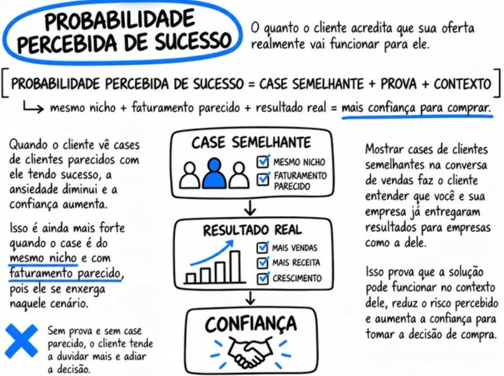

A R2 retoma o caso apresentado na R1 e aprofunda o que importa para a família. A fonte comum é CASOS.md.

| Referência | Como apresentar |
| --- | --- |
| David Willer | Expert da operação e responsável pelas trajetórias informadas |
| Kaio | Caso do David, no Internacional |
| Joãozinho | Caso do David, atuando profissionalmente no Grêmio |
| AGN Football | Braço complementar, com dezenas de atletas e atuação para o exterior |
| Histórico amplo | Centenas de jogadores encaminhados no Brasil e no mundo, conforme histórico informado pela operação |

- [Instagram do David Willer](https://www.instagram.com/dwilleroliveira/)
- [Instagram da AGN Football](https://www.instagram.com/agnfootball/)

### Uma prova que faz o pai parar para olhar

> "Você me pediu para entender se existe trabalho por trás da apresentação. Olha este caso: [publicação preparada]. Aqui está [resultado], aqui o vínculo com a equipe e aqui o que aconteceu ao longo do caminho."

> "Agora olha o plano do [atleta]. Qual dessas ações responde à dificuldade que vocês trouxeram?"

**Semelhança:** usar posição, idade e contexto só quando conhecidos. Um atleta conhecido chama atenção; um caso pertinente explica o caminho. Não transformar todo atleta do perfil da AGN em cliente nosso.

### Bastidor de 90 segundos

1. Pedir autorização para mostrar um exemplo.
2. Abrir um relatório ou trecho de devolutiva autorizado.
3. Apontar análise, orientação e próxima ação.
4. Voltar ao plano do atleta da chamada.

> "Vou te mostrar como uma análise vira acompanhamento. Este exemplo está autorizado para apresentação. Repara neste ponto: [evidência]. A partir dele, a equipe fez [ação real]."

### Consulta lateral real, sem teatro

Se houver uma dúvida e um colega disponível:

> "Vou confirmar esse prazo com quem acompanha a agenda. Posso pedir um minuto?"

Consultar de verdade, retornar com a resposta e registrar. Não simular conversa, assinatura, aprovação ou contratação de outro jogador. Bastidor convence quando a família consegue conferir o que está vendo.

## 15. Glossário dos cards

Conceitos de treinamento. A identificação pública continua gerente de carreiras. Números e exemplos desenhados nos cards não são métricas da operação.

### Probabilidade de sucesso

Caso comparável, prova e contexto. Mostrar o trabalho e o resultado específico.

### Tempo de execução inicial

Definir quando a primeira entrega acontece e quem responde por ela.

### Esforço percebido

Dividir responsabilidades de forma simples, sem prometer esforço zero.

### Valor percebido

Ligar cada entrega a uma mudança que a família considera importante.

### SDR

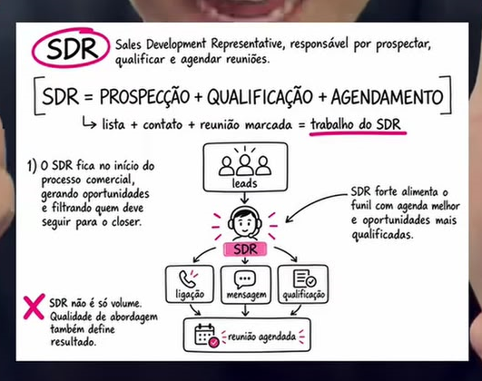

Função interna de prospecção e qualificação. Nome público: gerente de carreiras da R1.

### Closer

Função interna de proposta e fechamento. Nome público: gerente de carreiras da R2.

### SQL

Perfil, necessidade, interesse e momento compatíveis com o próximo passo.

### R1

Diagnóstico, compreensão da oferta e repasse qualificado.

### R2

Plano, prova, investimento, objeções e decisão.

### BANT

Necessidade, momento, decisão e orçamento. Conversa, não interrogatório.

### Sandler

Conexão, dor, impacto e compromisso antes da proposta.

### Lead speed

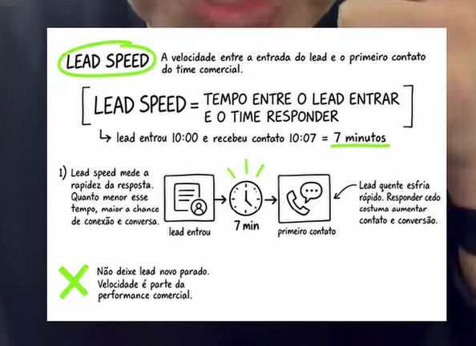

Tempo até a primeira resposta. Meta operacional de sete minutos na cobertura.

### No show

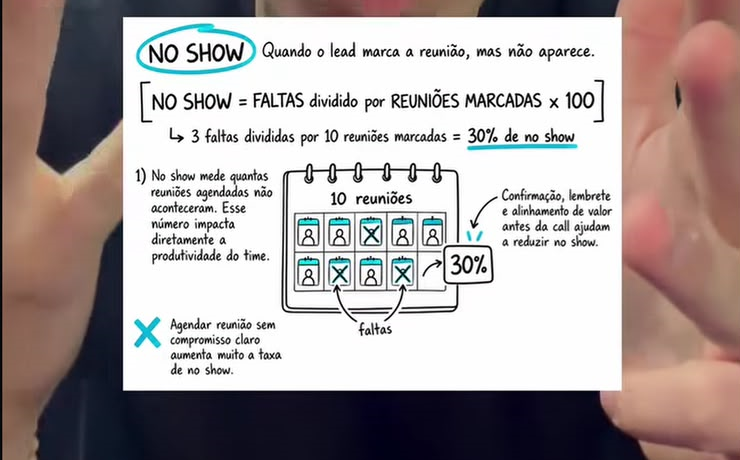

Faltas divididas por reuniões agendadas. Medir e melhorar confirmação.

### Follow up

Retomar com motivo útil, respeitando o combinado e recusas.

### Inside sales

Venda remota com processo e continuidade entre as pessoas.

### Win rate

Vendas ganhas divididas por oportunidades, com período e critério definidos.

### Lead magnet

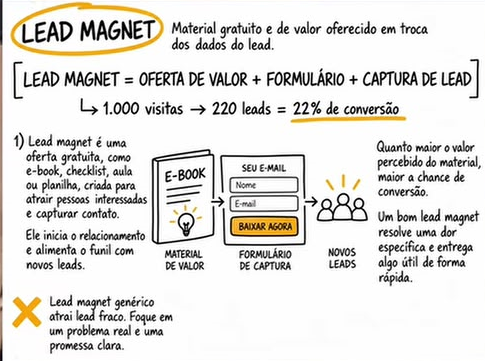

Uma entrega útil inicia a relação. Aqui, a avaliação orienta a conversa.

### Social selling

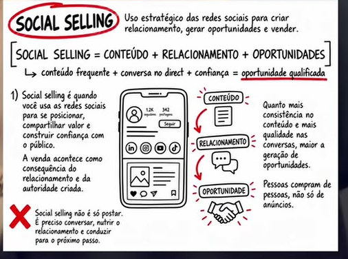

Relacionamento nas redes conectado a atendimento com contexto.

### Webinário

Conteúdo para educar sobre análise e acompanhamento.

### Conversão direta

Conceito de venda pela página. Esta operação mantém diagnóstico e proposta.

## 16. Dados para preparar antes de usar

1. Escopo, duração e diferença entre os planos de R$ 2.997, R$ 1.497 e R$ 497.
2. Material de reforço de ancoragem, com comparações e valores aprovados.
3. Condições reais de pagamento, total parcelado e eventuais encargos.
4. Nome do gerente responsável, canal e frequência do acompanhamento.
5. Agenda real de análise, devolutiva e início após contratação.
6. Exemplo atual da Zyron e casos autorizados com vínculo explicado.
7. Contrato, identificação institucional e canal oficial de pagamento.
8. Dados de prazo médio de encaminhamento, caso a operação queira usá-los: base, período e definição do resultado.

Última atualização: 28/09/2026 às 20:58 (Brasília, UTC−3).
